# Beacon UI（信标）

**给中兴 U60 Pro 换一套真正好用的屏幕界面。** 免费、开源（MIT）、不用电脑也能装。

Beacon UI 是 ZTE U60 Pro（SDX 系列 5G MiFi）前面板屏幕界面的 clean-room 开源实现：把原厂那块只会显示电量和信号格的小屏，变成一块能看信号质量、频段小区、实时速率、流量、电池、附近基站，还能锁频、测速、管 WiFi 的仪表盘。基于 [u60pro-devui](https://github.com/33333s/u60pro-devui) 继续开发，沿用 MIT 许可证。

<p align="center">
  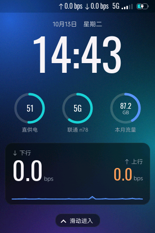
  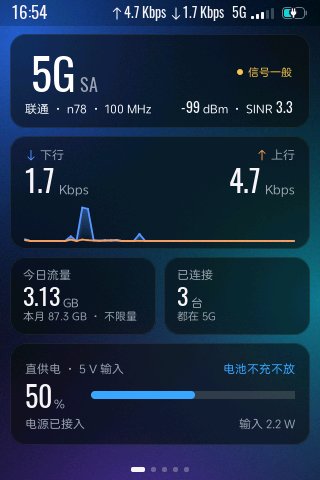
  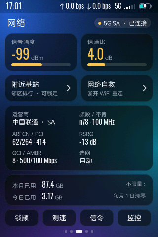
  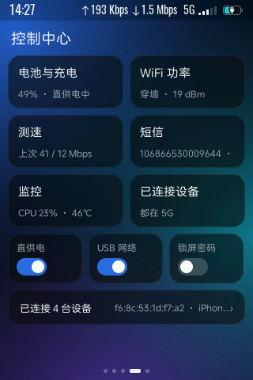
</p>
<p align="center"><sub>真机截图，320 × 480；「已连接设备」页给一台设备名打了码，其余未经修饰</sub></p>

> 💬 QQ 交流群 **76078845**　·　🌐 网站与安装说明 [vickydu.cn/u60](https://vickydu.cn/u60/install.html)　·　🐛 问题与建议 [工单页](https://vickydu.cn/u60/issues.html)

## 这块屏能做什么

**全部免费。** 下面每一项都包含在开源基础版里。

| | |
|---|---|
| **首页仪表盘** | 5G / 4G 状态、运营商、频段带宽、信号质量一句话评价；实时上下行速率曲线；今日和本月流量；电量、充电方式与输入功率 |
| **锁屏** | 大时钟、电量 / 制式 / 本月流量三个圆环、实时速率卡，上滑进入 |
| **网络页** | 信号强度与信噪比仪表、ARFCN / PCI / RSRQ / QCI / AMBR、选网方式；一键进附近基站、锁频、测速、信令、监控 |
| **附近基站** | 当前基站 PCI / ARFCN / RSRP / SINR，同频邻区实时排行，扫描全部 5G 频段看看附近还有哪些可用，点两次锁定到某个基站 |
| **锁频** | 5G / 4G 频段按钮式开关，5G SA / NSA / 4G 选网，一键全部恢复 |
| **测速** | 设备上直接跑测速，延迟 / 下载 / 上传，可选节点、方向和时长 |
| **信令读取** | 基站品牌识别、TA 估算距离，NR / LTE 的 RRC、NAS、MCS、MIMO、BLER 等实时信令（高级设置里按需开启） |
| **监控** | CPU、内存、网速、电池温度四条实时曲线 |
| **WiFi 管理** | 热点总开关，2.4G / 5G 分别控制，发射功率，扫码分享密码，已连接设备列表（IP、频段、协商速率） |
| **控制中心** | 电池与充电（直供电、充电上限、充电限流）、WiFi 功率、USB 网络、短信收件箱、锁屏密码、监控 |
| **设置** | 五套主题（深海、暮色、森林、晨雾、纯色）并可跟随壁纸自动切换深浅；亮度与自动息屏；WiFi 休眠与待机节能；唤醒封面、速率单位、电量百分比、反向供电、数据刷新频率 |
| **安装与更新** | 2333 插件中心一键安装；装好后联网自动更新；不改动原厂界面，连续崩溃 3 次自动交还原厂，不会黑屏 |

> **WiFi 中继**（把附近的 WiFi 当上游、同时继续发自己的热点）是付费的高级版功能，不在本仓库中。基础版屏幕上有入口，可直接扫码开通，详见[网站](https://vickydu.cn/u60/)。

## 更多截图

<table>
<tr>
<td align="center">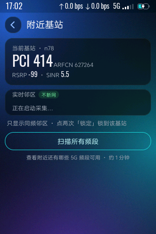<br><sub>附近基站</sub></td>
<td align="center">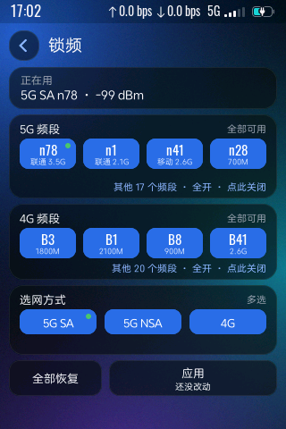<br><sub>锁频</sub></td>
<td align="center">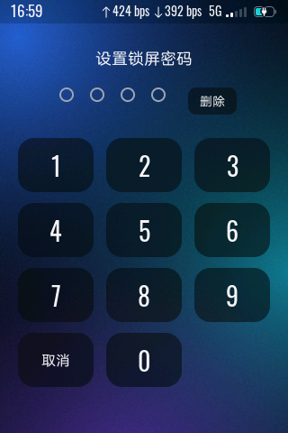<br><sub>测速</sub></td>
<td align="center">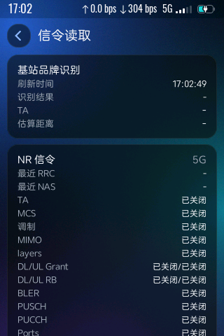<br><sub>信令读取</sub></td>
<td align="center">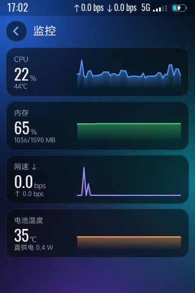<br><sub>监控</sub></td>
</tr>
<tr>
<td align="center">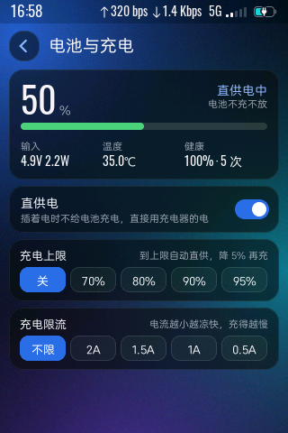<br><sub>电池与充电</sub></td>
<td align="center">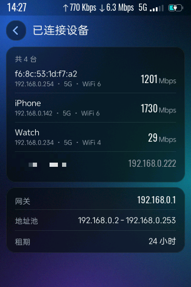<br><sub>已连接设备</sub></td>
<td align="center">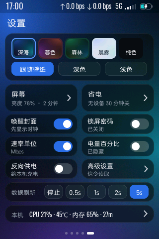<br><sub>设置与主题</sub></td>
<td align="center">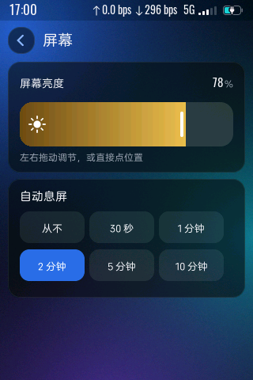<br><sub>屏幕</sub></td>
<td align="center">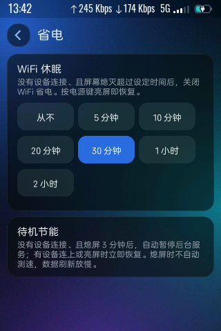<br><sub>省电</sub></td>
</tr>
</table>

## 安装

适用设备：中兴 U60 Pro，已开启 root。

**推荐：2333 插件中心一键安装，不用电脑**

1. 手机或电脑连上设备 WiFi，浏览器打开 `192.168.0.1:2333` 并登录。
2. 插件功能 → 插件商店，添加「U60 屏幕界面」。商店里还没有的话，下载[插件文件](https://vickydu.cn/u60/screen-plugin.txt)，用「添加插件 (.txt 文件)」导入。
3. 展开插件卡片，点「一键安装」。看到「安装完成」即可，屏幕几秒后换成新界面。

**备选：电脑 adb 安装**

```sh
# 从网站下载最新基础版安装包
curl -LOJ https://vickydu.cn/license/api/v1/dl/basic
tar xzf u60pro-devui-basic-*.tar.gz && cd u60pro-devui-basic-*/
bash install.sh            # 多台设备加 -s <序列号>；只检查不改动加 --check
```

需要 `adb devices` 能看到设备。macOS / Linux 用终端，Windows 用 Git-Bash 运行。

两种方式装的是同一个包：不改动原厂界面（出问题会自动交还给它），配置开机自启，不重启整机；重装或更新前会备份上一版界面。装好后插件联网自动更新，以后不用再装。

## 核心理念：程序固定，界面是数据

程序本身不内置任何画面。它在运行时读取 `/data/plugins/u60pro-devui/ui/` 下的 **HTML / CSS** 渲染到屏幕。想改界面，**不用重新编译**：改 HTML、推到设备，约 1 秒内生效。

```text
后端 zwrt-datad ──▶ HTTP /state + SSE /events (127.0.0.1:9460) ──┐
                                                                  ├─▶ u60pro-devui ──▶ 屏幕（DRM/KMS）
你写的 ui/*.html + style.css ─────────────────────────────────────┘
```

- **渲染**：[litehtml](https://github.com/litehtml/litehtml) 排版 + FreeType 字体，直接画进 RGB565 framebuffer。无浏览器、无 JavaScript，状态只经本机 HTTP / SSE 读取。
- **显示**：[src/drm_disp.c](src/drm_disp.c) 打开 `/dev/dri/card0`，映射 dumb framebuffer，`DIRTYFB` 提交。
- **触摸**：[src/touch_input.c](src/touch_input.c) 自动探测触摸屏并缩放坐标；电源键短按息屏、长按菜单。
- **界面**：`ui/` 下每个顶层 `NN-名字.html` 一页，按文件名排序横滑；`style.css` 共享样式；`ui/subpages/` 是二级页；`ui/functions/` 放你自己的功能页（见 [examples/custom-functions](examples/custom-functions)）。HTML 里的 `{{令牌}}` 由程序替换成实时数据，`href="act:xxx"` 触发交互。
- **后端**：[zwrt-datad](https://github.com/33333s/zwrt-datad) 轮询 `ubus`，通过 `GET /state` 和 `SSE /events` 提供 JSON 快照；界面从不直接碰 ubus。
- **外部接口**：内建 `DEVUI-IPC`，其他进程可把内容投到状态栏下方的内容区，并通过点击事件驱动自己的逻辑。

👉 **想自己写界面，看这份教程：[docs/UI-GUIDE.md](docs/UI-GUIDE.md)**

## 从源码构建

需要 WSL / Linux，不需要 root，不要求预装 `make`。工具链是可搬运的 aarch64 musl，下载到 `$HOME`。

```sh
bash scripts/_setup_toolchain.sh    # 一次性：下载 aarch64 musl 工具链
bash scripts/_build_freetype.sh     # 一次性：静态 FreeType
bash scripts/_build_litehtml.sh     # 一次性：静态 litehtml（先打 scripts/litehtml-css-cache.patch）
bash scripts/build.sh               # 产出 ./u60pro-devui 和 ./u60pro-devui.stripped
```

产物是单个静态 AArch64 ELF，无动态依赖。

**手动推到设备跑起来**（开发调试用，正式安装请走上面的安装包）：

```sh
adb shell 'mkdir -p /data/plugins/u60pro-devui/ui'
adb push ui/. /data/plugins/u60pro-devui/ui/
adb push u60pro-devui.stripped /data/plugins/u60pro-devui/u60pro-devui
adb shell '/etc/init.d/zte_topsw_devui stop; sleep 1;
           chmod 755 /data/plugins/u60pro-devui/u60pro-devui;
           nohup /data/plugins/u60pro-devui/u60pro-devui >/tmp/devui.log 2>&1 &'
```

开机自启用 `scripts/install-autostart.sh`：保留原厂 `zte_topsw_devui` 做早期屏幕 / 触摸初始化，再由 `rc.local -> start.sh legacy` 晚接管，`guard.sh` 负责崩溃自愈。细节见 [docs/DEVELOPMENT.md](docs/DEVELOPMENT.md)。

**调试小工具**（`scripts/`）：`fb_pull.py` 拉 framebuffer 存 PNG，`touchsim.py` 模拟点击和滑动，`stream_viewer.py` 实时镜像屏幕并可点击。本页所有截图就是用 `fb_pull.py` 拉的。

## 发版约定

`version.json` 里 `devui`（二进制）和 `ui`（界面模板）两个版本号独立：改二进制只升 `devui`，改 `ui/` 只升 `ui`。Release 资产固定三个文件名：`u60pro-devui-aarch64`、`ui.tar.gz`（顶层平铺，不带 `ui/` 目录）、`version.json`。

```sh
bash scripts/build.sh
cp u60pro-devui.stripped u60pro-devui-aarch64
(cd ui && COPYFILE_DISABLE=1 tar -czf ../ui.tar.gz -- *.html *.css subpages)
```

## 文档

- [docs/UI-GUIDE.md](docs/UI-GUIDE.md) — **自定义界面教程**：令牌、动作、限制、示例
- [docs/DEVELOPMENT.md](docs/DEVELOPMENT.md) — 架构、构建、数据模型、踩坑记录
- [docs/SIGNAL-CARDS.md](docs/SIGNAL-CARDS.md) — 首页信号卡片与锁屏预览口径
- [docs/SPEEDTEST.md](docs/SPEEDTEST.md) — 测速后端与测速页
- [docs/modem.md](docs/modem.md) — 信令页 / 基站信息页的字段口径
- [docs/DEVUI-IPC.md](docs/DEVUI-IPC.md) — 外部画面接口（像素帧、图片、绘图命令、文字）
- [docs/HARDWARE.md](docs/HARDWARE.md) — 设备硬件接口
- [docs/REPO_BOUNDARY.md](docs/REPO_BOUNDARY.md) — 公开仓库与本地记录的边界

## 许可证与边界

MIT，见 [LICENSE](LICENSE)。litehtml（BSD）、FreeType（FTL / GPL 双授权）、stb（public domain）按各自许可证引入。

仓库不包含任何 ZTE 的二进制、字体或分析产物，字体运行时从设备 `/usr/ui/fonts/` 加载。请只提交开源许可的资源，`.gitignore` 已拦截常见的 vendor blob。本项目为非官方第三方软件，与中兴通讯无关联，按现状提供。
